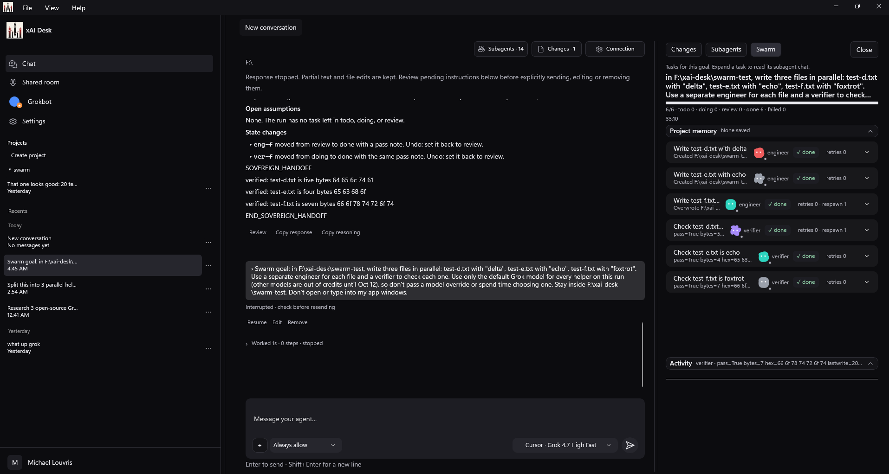
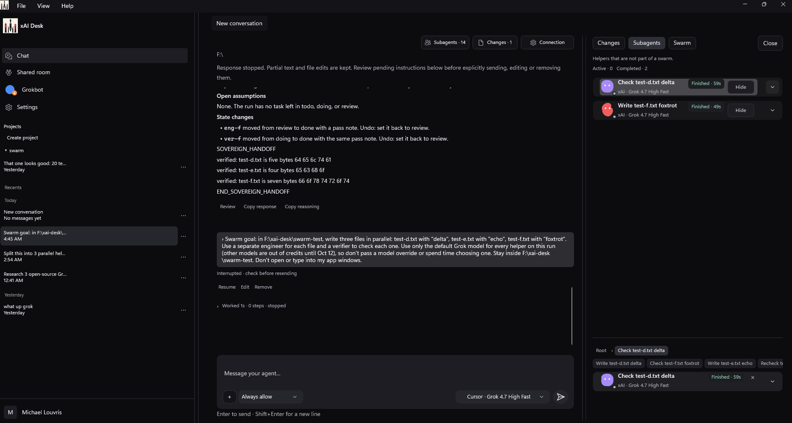
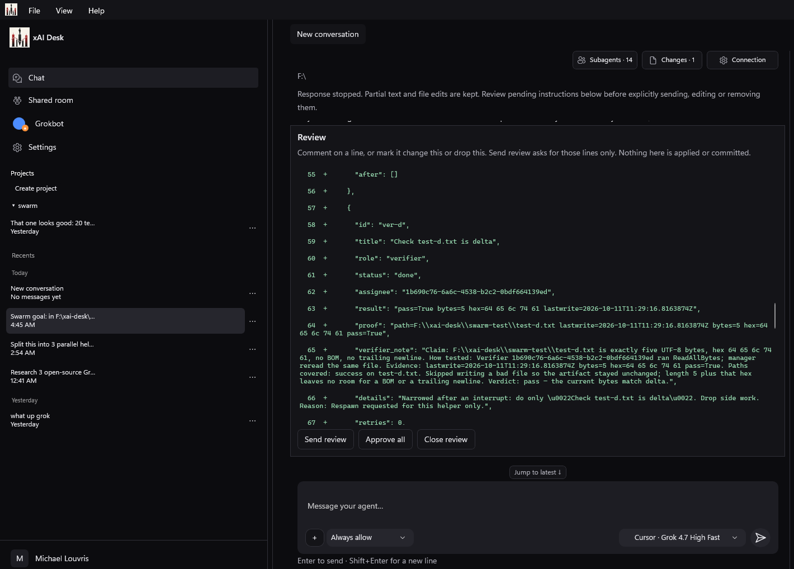
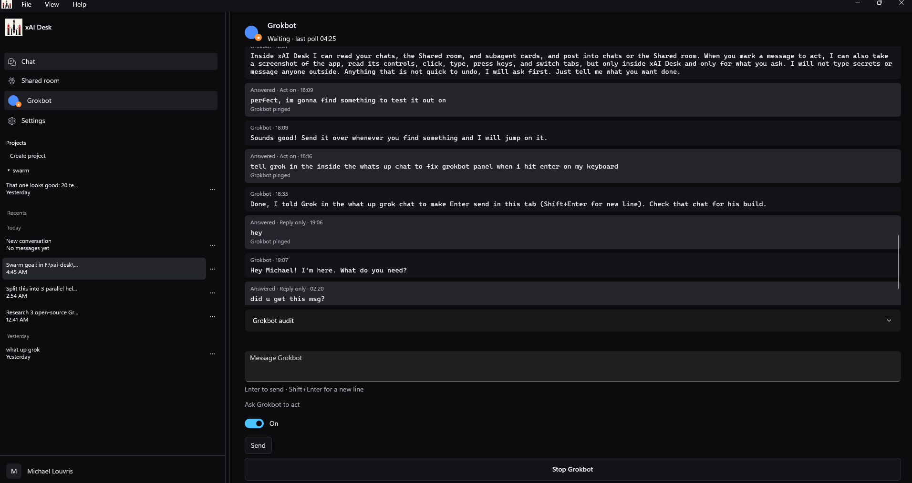

# xAI Desk

xAI Desk is an unofficial, community-built Windows desktop app for Grok.
It is **not affiliated with, endorsed by, or supported by xAI.**
SpaceXSI, xAI and Grok are trademarks of their respective owners. This project is independent and is not affiliated with or endorsed by them.

## Quick install

Download the zip from the latest release, unzip, run xAIDesk.exe.
Windows 10 or 11 x64, nothing else to install.
The build is unsigned, so Windows SmartScreen will warn: click More info, then Run anyway.

## Features

- **Chat** with File > Open Folder, so Grok can work on your code.
- **Three ways to connect:**
  - a Cursor subscription on this PC, which can select Grok models
  - the Grok Build CLI on this PC, using the subscription that CLI is signed in with
  - an API key sent to the xAI API
- **Subagents** that help with parts of a task.
- **Swarm mode.** A manager splits a goal into parallel engineer, fact-finding and verifier tasks. Nothing counts as done until a verifier proves it. If a worker fails, you can press Respawn to retry it once.
- **Changes review tab** to look over edits before you keep them.
- **Grok Bot connector** (optional) to add a main assistant.
- **Shared room** to build together. Send an invite and other people can join.

## Screenshots


*Swarm: a goal split into engineer and verifier tasks, all done.*


*Subagents: helper cards with model, status and run time.*


*Changes: line-by-line review of an agent's file edits before anything is applied.*


*Grokbot: an assistant that reads your chats and can act inside xAI Desk when you allow it.*

## Requirements

- Windows 10 or 11 (x64)
- One connection: a Cursor subscription, the Grok Build CLI, or an API key for the xAI API
- Cursor users run `scripts\Install-CursorConnection.ps1` once
- Shared Room downloads cloudflared on first use
- The .NET SDK is only needed to build from source

## Build

From the repo root:

```
dotnet build apps/desktop/Sovereign.Desktop -c Debug -p:Platform=x64
```

This is the expected build command. Please check it against the project files before you rely on it.

## Shared room setup

Shared room invites need cloudflared, which is not included in this repo. On first use it is downloaded automatically, pinned to 2026.10.0, SHA256 verified, and saved to `%LOCALAPPDATA%\xai-desk\tools\cloudflared.exe`.

## Status

Public beta. Expect rough edges, and bug reports are welcome.

## Credits

See [THIRD_PARTY_NOTICES.md](THIRD_PARTY_NOTICES.md).

## Author

Built by Michael Louvris. Find me on X: [@grokbuildAI](https://x.com/grokbuildAI)

## License

MIT. See [LICENSE](LICENSE).
